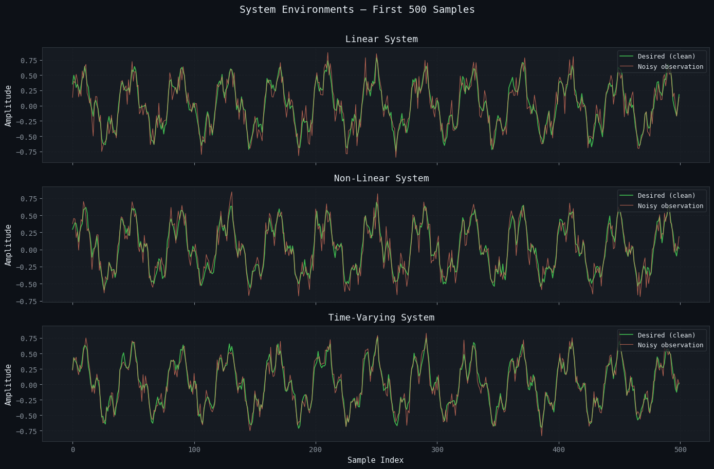
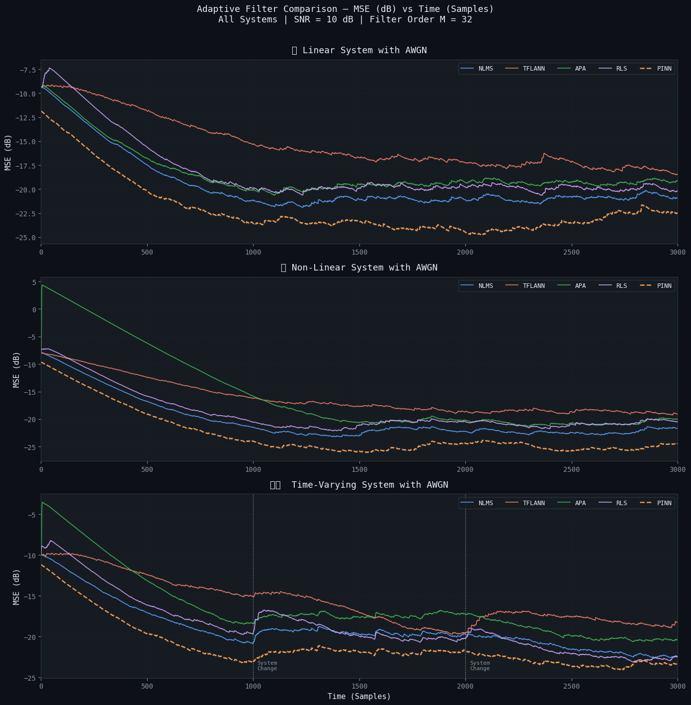
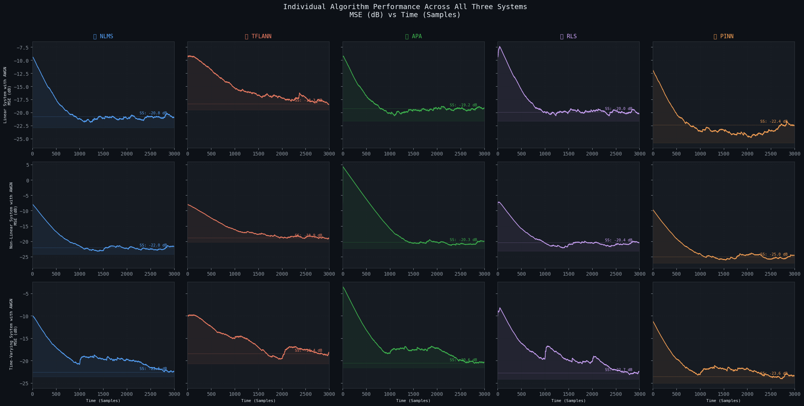
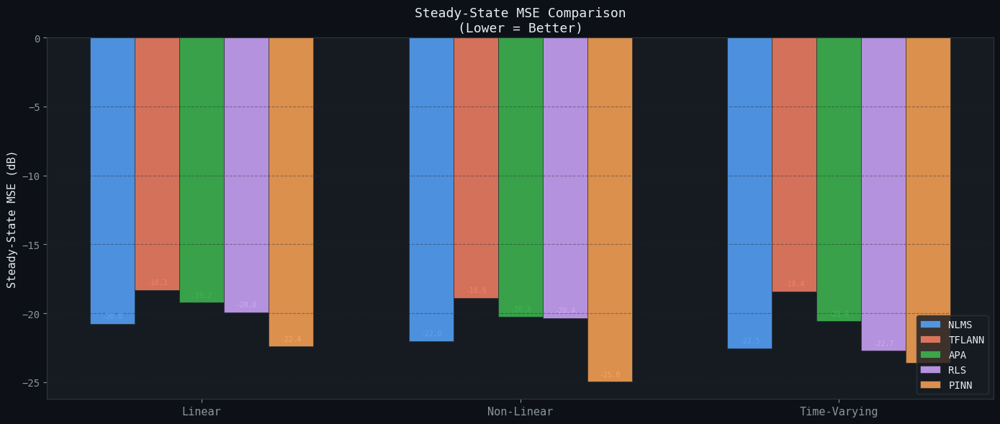
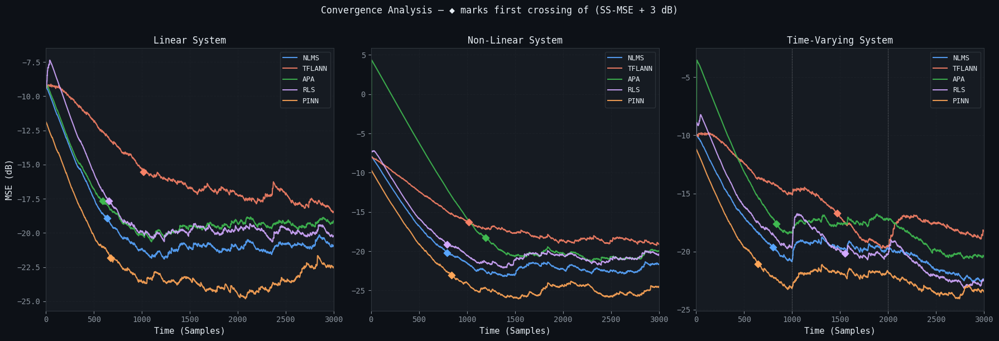
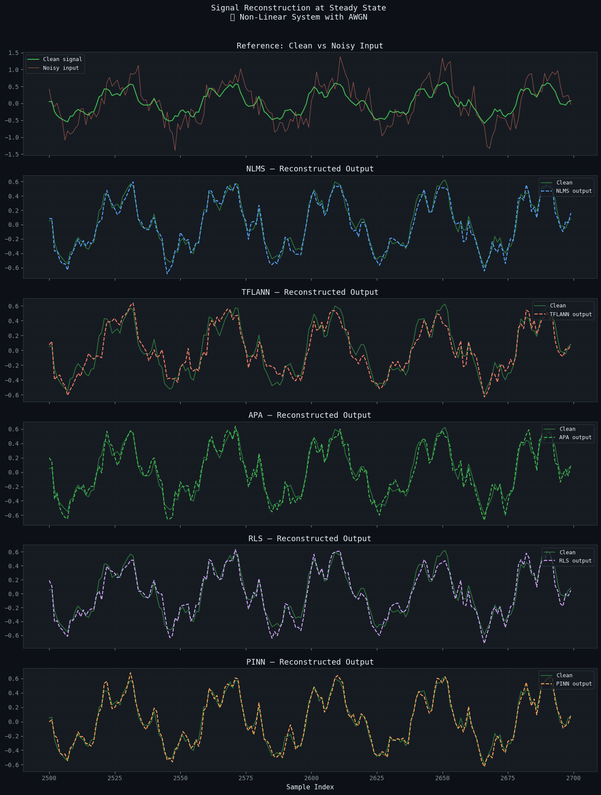

# PINN vs Classical Adaptive Filters for Noise Cancellation

M.Tech course project, IIT Gandhinagar (2026). Author: **Vishrut Sharma**.

A Jupyter notebook that compares a **physics-informed neural network (PINN)** adaptive filter with
four classical adaptive filters — **NLMS, TFLANN, APA and RLS** — on three simulated systems, using
MSE (dB) learning curves, steady-state MSE and convergence speed.

Open [`PINN_Adaptive_Filters.ipynb`](PINN_Adaptive_Filters.ipynb) to see the code with all outputs.

## Setup

**Signals** (N = 3000 samples, fs = 8 kHz): the input is 0.7·sin(2π·200t) + 0.3·sin(2π·800t)
plus a small white-noise component. Three unknown systems produce the desired signal:

| System | Definition |
| --- | --- |
| Linear | 5-tap FIR, h = [0.5, 0.3, −0.2, 0.1, −0.05] |
| Non-linear | same FIR, then d + 0.15d² − 0.05d³ and a tanh soft saturation |
| Time-varying | FIR coefficients switch at N/3 and 2N/3 (three different 5-tap filters) |

White Gaussian noise at **5 dB SNR** is added to the reference fed to every filter.



**Filters** (filter order M = 32 unless noted):

| Filter | Settings |
| --- | --- |
| NLMS | μ = 0.5 |
| TFLANN | 16 taps, trigonometric expansion order P = 2, μ = 0.02 |
| APA | projection order K = 4, μ = 0.5 |
| RLS | forgetting factor λ = 0.98, δ = 100 |
| PINN | MLP 32 → 128 → 128 → 64 → 1 (tanh), Adam (lr = 5×10⁻⁴), 5 gradient steps per sample, pre-trained on the first 500 samples |

The PINN loss is the data MSE plus a **temporal-smoothness** term (weight 0.1) that penalises the
difference between predictions for consecutive windows over the last 10 samples:

L = (1/N) Σ (ŷᵢ − dᵢ)² + λ_smooth · (1/(K−1)) Σ (ŷ(tᵢ₊₁) − ŷ(tᵢ))²

## Results

MSE (dB) learning curves, smoothed with an exponential moving average (α = 0.995):





**Steady-state MSE** (mean over the last 20 % of samples, dB, lower is better):

| Algorithm | Linear | Non-linear | Time-varying |
| --- | ---: | ---: | ---: |
| NLMS | −20.78 | −22.02 | −22.55 |
| TFLANN | −18.33 | −18.88 | −18.42 |
| APA | −19.23 | −20.25 | −20.58 |
| RLS | −19.95 | −20.36 | −22.73 |
| PINN | −22.41 | −24.97 | −23.59 |



**Convergence** (first sample within 3 dB of the curve's minimum, lower is faster):

| Algorithm | Linear | Non-linear | Time-varying |
| --- | ---: | ---: | ---: |
| NLMS | 637 | 793 | 803 |
| TFLANN | 1019 | 1019 | 1468 |
| APA | 593 | 1195 | 836 |
| RLS | 656 | 792 | 1550 |
| PINN | 672 | 839 | 644 |



Denoised output on a steady-state segment (samples 2500–2700):



More: [linear](images/reconstruction_linear.png) · [time-varying](images/reconstruction_timevarying.png).

## Notes on the comparison

- The classical filters report the *a-priori* error (prediction before the weight update). The PINN
  takes 5 gradient steps on the current sample before its error is recorded, and it is pre-trained
  on the first 500 samples, so its curves are not a like-for-like comparison.
- The PINN costs far more computation per sample (an MLP with ~30 k parameters trained online)
  than the classical filters (NLMS costs O(M) per sample).
- Some plot titles say "SNR = 10 dB"; the runs above used the configured 5 dB.

## Running

```bash
pip install numpy scipy matplotlib torch
jupyter notebook PINN_Adaptive_Filters.ipynb
```

The notebook was developed on Google Colab; it runs on CPU (the PINN section takes a few minutes).
Seeds are fixed (`np.random.seed(42)`, `torch.manual_seed(42)`).

## References

1. M. Raissi, P. Perdikaris, G. E. Karniadakis, "Physics-informed neural networks," *J. Comput. Phys.*, 378, 2019.
2. S. Haykin, *Adaptive Filter Theory*, 4th ed., Prentice Hall, 2002.
3. J. C. Patra, R. N. Pal, "A functional link artificial neural network for adaptive channel equalization," *Signal Processing*, 1995.
